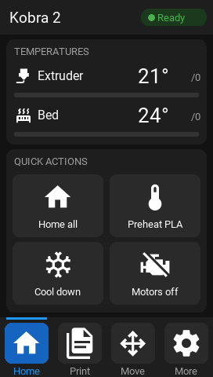
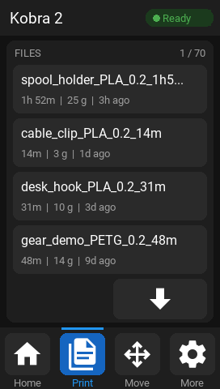
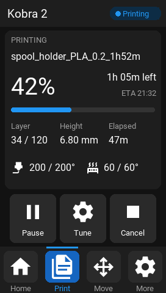
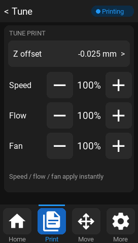
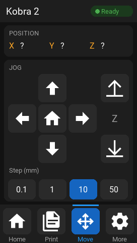
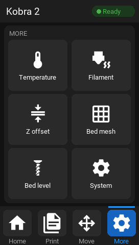
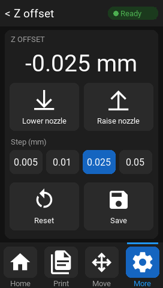
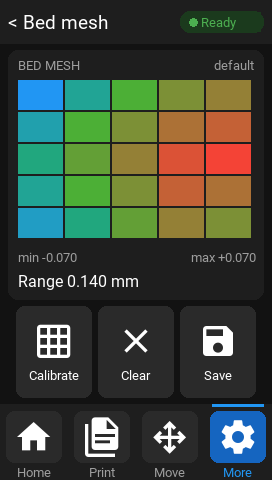

# Kobra 2 TJC screen for Klipper

Brings the **stock touchscreen of the Anycubic Kobra 2** back to life after
switching the printer to Klipper. The screen stays on its original cable
and mainboard connector; no extra wiring to the Raspberry Pi.

| Home | Print | Printing | Tune |
|---|---|---|---|
|  |  |  |  |
| **Move** | **More** | **Z offset** | **Bed mesh** |
|  |  |  |  |

*Mockups rendered from the same layout code that drives the screen.*

## Features

- Mainsail-style dark UI with Roboto text and Material Design icons
- Live temperatures with heating bars, printer status chip
- Print tab: file list with slicer estimates, start a print, progress, time
  left / ETA, layer, pause / resume / cancel
- Tune during a print: Z offset, speed, flow, fan
- Move (jog, home), temperatures and presets, filament load / unload / M600,
  Z offset with save, bed mesh heat-map, screw tilt adjustment, emergency stop
  and restarts
- Follows the printer: prints and long commands started from Mainsail show up
  on the screen; controls that would ruin a print are greyed out while printing
- Boot animation stored in the screen, played at power-on and after restarts
- Recovers by itself when the printer is power cycled while the Pi stays on

## How it works

```
TJC screen ── stock cable ──> mainboard USART4 ──(existing USB link)──> Pi
                               serial_bridge.c       serial_bridge.py → pty → kobra_screen.py ↔ Moonraker
```

Upstream Klipper can't forward a spare mainboard UART to the host, so this
project adds a small Klipper extension that does. The screen firmware only
stores fonts, icons and the boot animation; the Pi draws everything else.
Details in [docs/architecture.md](docs/architecture.md).

> **Note**: the mainboard part is a patch on top of Klipper, not part of
> upstream Klipper. It also fixes a timing bug in Klipper's HC32F460 serial
> driver ([details](docs/hardware-notes.md#klippers-hc32f460-serial-driver-bug)).

## Requirements

- Anycubic **Kobra 2** (original) with its stock HC32F460 mainboard, running
  Klipper, connected to a Raspberry Pi over USB
- The stock touchscreen (TJC4827X243_011)
- Moonraker (e.g. MainsailOS) and `arm-none-eabi-gcc` on the Pi
  (installed with Klipper's usual build dependencies)
- An SD card (FAT32, ≤ 32 GB) for flashing

Tested with Klipper v0.13.0-786 on a Raspberry Pi 3A+ with MainsailOS.

## Installation

Run everything on the Pi unless noted.

**1. Get the code**

```sh
git clone https://github.com/dr-tchock/kobra2-tjc-klipper.git ~/kobra2_screen
```

**2. Build the mainboard firmware** (Klipper + bridge)

```sh
~/kobra2_screen/klipper-bridge/build_mcu.sh
```

This builds in `~/kobra_builds/klipper-bridge` at the same version as your
`~/klipper`, using `klipper-bridge/mcu.config` (HC32F460, 168 MHz, serial on
PA15/PA9 at 250000, application at 0x10000, bridge enabled). If your board
uses different settings, adjust that file first
(`make menuconfig KCONFIG_CONFIG=...`). Output: `~/kobra2_screen/firmware/firmware.bin`.

**3. Flash the mainboard**

Copy `firmware.bin` to the root of the SD card (only file on it). Power the
printer off, **unplug the Pi's USB cable**, insert the card into the
**mainboard** slot, power on and wait 1–2 minutes. Power off, remove the
card, plug the USB back in, power on.

**4. Enable the bridge in Klipper**

```sh
~/kobra2_screen/klipper-bridge/install_host.sh
```

Add to `printer.cfg`, then restart Klipper:

```ini
[serial_bridge]
baud: 115200
```

**5. Flash the screen**: see [tft/README.md](tft/README.md) (SD card in the
slot under the touchscreen).

**6. Start the screen program**

```sh
~/kobra2_screen/screen/install_service.sh
```

**Optional: updates from Mainsail.** Add to `moonraker.conf`:

```ini
[update_manager kobra2_screen]
type: git_repo
path: ~/kobra2_screen
origin: https://github.com/dr-tchock/kobra2-tjc-klipper.git
primary_branch: main
managed_services: kobra-screen
```

## Updating Klipper

Updating Klipper from Mainsail is fine; the Pi-side module survives updates.
Only when Klipper asks you to update the mainboard firmware, run
`build_mcu.sh` again and flash as in step 3. **Don't flash a plain Klipper
build**: it lacks the bridge, and Klipper then stops with
"Unknown command: config_serial_bridge".

`build_mcu.sh` refuses to build if a Klipper update changed the serial driver
code it patches, so the fix gets reviewed instead of silently lost.

## Troubleshooting

| Symptom | What to do |
|---|---|
| Screen stays on the boot logo | Klipper not ready or USB cable unplugged. Check Mainsail; after a printer power cycle it recovers by itself within a few minutes. |
| `Unknown command: config_serial_bridge` | The mainboard runs firmware without the bridge: build and flash with `build_mcu.sh`. |
| Klipper won't start, error mentions `serial_bridge` | Comment out `[serial_bridge]` (the printer then works without the screen) and open an issue. |
| `serial_bridge: line errors (flags=4…)` in klippy.log | Normal, about 12 per screen reboot ([why](docs/hardware-notes.md#framing-errors-in-klippylog)). |
| Screen program log | `~/printer_data/logs/kobra_screen.log` |

**Going back to stock**: remove `[serial_bridge]`, flash a normal Klipper
build, and flash Anycubic's original screen `.tft`.

## Repository layout

| Path | Contents |
|---|---|
| [klipper-bridge/](klipper-bridge/) | Klipper extension, build and install scripts |
| [screen/](screen/) | Screen program and page layouts |
| [tft/](tft/) | Ready-to-flash screen firmware and its fonts |
| [assets/](assets/) | Icons, boot animation, font character set |
| [tools/](tools/) | Icon generator, mockup renderer, helpers |
| [tests/](tests/) | Link tests and UI dry run |
| [docs/](docs/) | Architecture, hardware notes, rebuilding the `.tft`, development |

## Credits

- [Klipper](https://www.klipper3d.org/) and [Moonraker](https://github.com/Arksine/moonraker)
- Anycubic's published [Kobra 2 source](https://github.com/ANYCUBIC-3D/Kobra2) (screen pins)
- [UNUF/nxt-doc](https://github.com/UNUF/nxt-doc) and [TFTTool](https://github.com/UNUF/TFTTool) (TFT format)
- [Material Design Icons](https://pictogrammers.com/library/mdi/), [Roboto](https://github.com/googlefonts/roboto)
- Inspired by [KlipperScreen](https://github.com/KlipperScreen/KlipperScreen) and [Mainsail](https://docs.mainsail.xyz/)

## License

GPL-3.0 (see [LICENSE](LICENSE)), like Klipper. Icon and font licenses:
[assets/README.md](assets/README.md). Anycubic and Kobra are trademarks of
Anycubic; this project is not affiliated with them.
