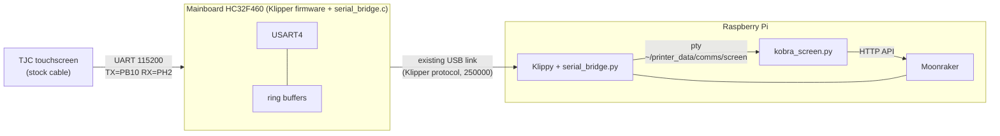

# How it works

## 1. The serial bridge (Klipper extension)

Under Klipper, the mainboard runs only a small firmware that executes timed
commands from the Pi. Upstream Klipper has no way to pass a spare UART (like
the screen header) through to the host, so this project adds one:

- **`klipper-bridge/src/hc32f460/serial_bridge.c`**: runs USART4 on the
  screen header pins (PB10/PH2, the same peripheral and pins Anycubic's
  firmware uses for the screen). Received bytes go into a ring buffer and are
  sent to the host in batches (once the line has been quiet for three byte
  times, or 48 bytes are waiting). Host data is queued and sent by interrupt.
  Pins are reserved so the printer config can't use them.
- **`klipper-bridge/klippy/extras/serial_bridge.py`**: configures the bridge
  and exposes it as a raw pseudo-terminal. Writes are paced to the screen's
  baud rate so the small MCU buffer can't overflow.
- **`klipper-bridge/apply.sh`**: adds the C file, a Kconfig option and a
  Makefile line to a Klipper tree, and patches Klipper's HC32F460 serial
  driver (see [hardware-notes.md](hardware-notes.md)).

The bridge is inert until `[serial_bridge]` is in `printer.cfg`, and Klipper
updates leave it alone (the host module is an untracked symlink).

## 2. The screen firmware

The `.tft` holds only what must live in the screen: the boot animation, five
Roboto sizes, and 67 icons. There are no buttons or pages in it.

## 3. The screen program (`screen/`)

`kobra_screen.py` runs as the `kobra-screen` systemd service. It talks to the
screen through the pty and to the printer through Moonraker.

- **Drawing**: pages are painted with TJC drawing commands (`fill`, `cirs`,
  `xstr` text, `pic` for stored icons). A full page is ~3 KB, ~0.3 s.
- **Touch**: `sendxy=1` makes the screen report raw coordinates; the program
  hit-tests them against the buttons of the current page.
- **Layouts** (`ui.py`): each page is a class that draws itself and returns
  its buttons. A button knows its area, how to paint itself (normal, pressed,
  disabled) and whether it is allowed right now. The same code renders PNG
  mockups on a PC (`tools/mockup.py`).
- **Following the printer**: every 1.5 s it reads Klipper's state and redraws
  what changed. A print started from anywhere switches to the Print tab. A
  long command started elsewhere (Moonraker's command history, e.g. a bed
  mesh from Mainsail) switches to its page. While a print or a long command
  runs, buttons that would ruin the print or only queue behind it are greyed
  out; navigation, pause/cancel and emergency stop always work.
- **Boot handling**: the screen plays its animation by itself at power-on.
  The program waits for it to finish, hides it and draws the UI. After a
  Klipper or firmware restart (screen kept running) it reboots the screen so
  the animation plays again, at most once a minute.
- **Auto-recover**: if the mainboard was power cycled while the Pi stayed on
  ("Lost communication with MCU"), it triggers a firmware restart, with
  backoff. Real faults (heaters, ADC, timers) are left alone.
